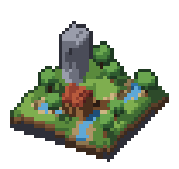
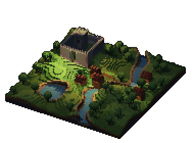
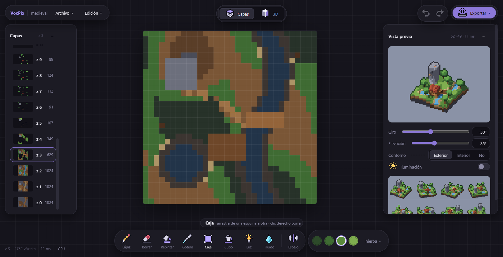
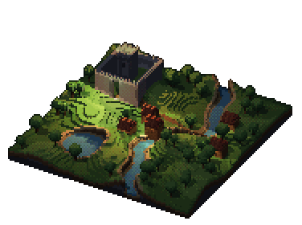
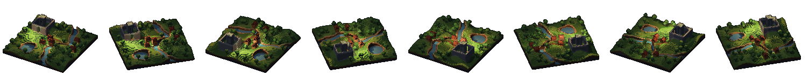
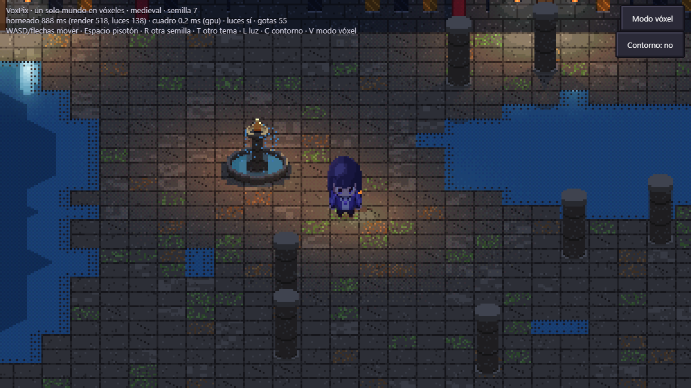
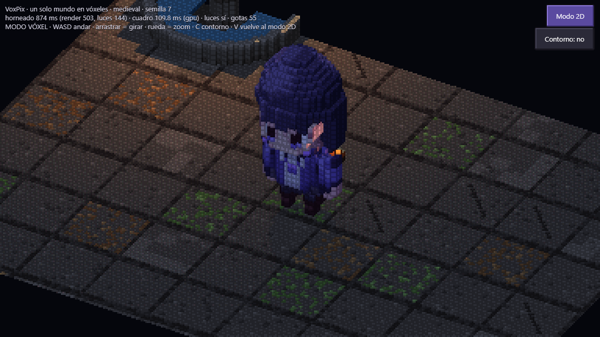

# VoxPix

**Voxel models to pixel art, in the browser.** You build a model layer by layer or directly in 3D, light it, add
water, and export it as pixel-art sprites. Underneath there is a deterministic renderer and a 2.5D voxel-world
engine (dynamic lighting, water, entities, CPU and GPU compositing) you can build a game on. TypeScript, Vue 3 and
WebGL2. MIT licensed.

**AI-driven.** VoxPix is built by a team of AI agents (Claude Code) directed by a human, and it is made to be driven
by AI agents too: everything the editor does is available, without a mouse, through `window.voxpix`. See
[docs/ia.md](docs/ia.md).

VoxPix es un editor de vóxeles que pinta pixel art. Se modela por capas o sobre el modelo en 3D, se ilumina con
fuentes de luz, se le echa agua y sale en sprites de pixel art: uno por ángulo, en hojas o en PNG. Debajo hay un
núcleo de render determinista y un motor de mundo 2.5D (luz dinámica, agua, entidades y composición por CPU y por
GPU) sobre el que se puede hacer un juego.

La app arranca con una escena de muestra: un rincón medieval de 32 x 32 vóxeles con torre, casa, río, puente,
estanque, árboles y luces (`src/samples/medieval.ts`).

  
  

## AI-driven: hecho por agentes, para agentes

- **Hecho por agentes de IA.** El código, los modelos de ejemplo, las pruebas y la documentación los escriben
  agentes de IA (sesiones de Claude Code) que trabajan como un equipo, cada uno con su papel, bajo la dirección de
  una persona que decide qué se hace y aprueba el arte. Para que no sea solo plausible:
  - cada atajo de la GPU se compara píxel a píxel con la CPU;
  - todo es determinista;
  - se mide antes de optimizar.
- **Para que lo usen agentes.** `window.voxpix` hace sin ratón todo lo que hacen las herramientas. Los formatos son
  texto (`.voxpix.json`, `.px.js`) y las salidas se pueden comprobar midiendo píxeles. Un agente hace un paisaje
  de 128 x 128 en 0,08 s de ediciones.

Más en [docs/ia.md](docs/ia.md).

## Documentación

[docs/](docs/README.md):
- [el editor](docs/editor.md);
- [la API para agentes](docs/api-agentes.md);
- [IA](docs/ia.md);
- [el render](docs/render.md);
- [el motor del mundo](docs/motor.md);
- [la línea de comandos](docs/linea-de-comandos.md);
- [las pruebas](docs/pruebas.md).

## Capturas

**El editor por capas.** Cada altura z se pinta vista desde arriba, con la capa de debajo en fantasma. La vista
previa de la derecha es el mismo render que se exporta.

**Lo que sale.** Este paisaje de 128 x 128 está hecho solo con la API para agentes (`scripts/api/paisaje-medieval.js`):
terreno, río, lago, castillo, casas, árboles y 11 luces, exportado de noche y en sus 8 ángulos.

**El motor del mundo** (`app/escena.html`). Un escenario generado por semilla, con MAIA andando con su antorcha, luces
dinámicas, sombras y agua. Abajo, el mismo mundo en el modo 2D, compuesto por la GPU, y en el modo vóxel.

## Empezar

    npm install
    npm run dev        # el editor en http://localhost:5190
    npm test           # las pruebas (Vitest)
    npm run build      # la app en app/dist (el editor, la demo del mundo y las páginas de prueba)

Hace falta Node 20 o posterior. El editor funciona en cualquier navegador con WebGL2. Sin WebGL2, todo pasa a la
CPU, que da los mismos píxeles, solo que más despacio.

## El editor (`app/`)

- **Capas y 3D.** Se pinta capa a capa (vista desde arriba) o sobre el modelo en 3D. En 3D, el botón derecho
  gira, el del medio mueve y la rueda acerca.
- **Herramientas:** lápiz, borrar, repintar, cuentagotas, caja, cubo de pintura, fuentes de luz, fluido (verter,
  grifo o llenar hasta un nivel) y espejo.
- **Paleta por rampas** editable:
  - rampas generadas desde un color, con giro de tono como en el pixel art;
  - cada tono con su selector de color;
  - las paletas de la comunidad (PICO-8, Endesga, AAP-64...) o un `.hex`/`.gpl` de Lospec.
- **Vista previa** con giro, elevación, contorno exterior o interior e iluminación con las fuentes del modelo, como
  en el juego.
- **Exportar:** sprites para pxl (N ángulos o capas), el modelo (`.voxpix.json`) y PNG de una vista o de una hoja
  de ángulos, iluminado si la luz está encendida.
- **Lienzo** del tamaño que haga falta (Edición > Tamaño del lienzo; hasta 256 por lado).
- **Render por GPU** (WebGL2) con la misma salida que la CPU. Lo comprueba `app/oraculo-render.html`. La barra de
  estado dice cuál se usa; `?ruta=cpu` fuerza la CPU.

### API para agentes y scripts

`window.voxpix` hace sin ratón lo mismo que las herramientas: pintar, cajas, rellenos, agua, luces, paleta, lienzo,
abrir y guardar, vista y PNG. Cualquier cosa que controle un navegador (la consola, Playwright o CDP) puede
construir modelos con ella. `voxpix.help()` la explica; la referencia está en [docs/api-agentes.md](docs/api-agentes.md)
y `scripts/api/` trae un ejemplo que hace un paisaje medieval de 128 x 128.

## La línea de comandos

    npm run voxpix -- render <modelo.json|sample> salida.png [--yaw 0] [--elev 30] [--turn 8] [--scale 8] [--size WxH]
    npm run voxpix -- export-pxl <modelo.json|sample> salida.px.js [--turn 8]
    npm run voxpix -- import-pxl arte.px.js <sprite|-> modelo.json
    npm run voxpix -- import-pxl arte.px.js --stack <prefijo> modelo.json      # capas <prefijo>_zNN

Sin `--size`, el encuadre se ajusta al modelo: 64x48 si cabe; si no, uno que lo contiene en cualquier giro.

Un GIF del modelo dando una vuelta (los de arriba salen de aquí; `--luz` lo ilumina con las fuentes del modelo):

    npx tsx --tsconfig tsconfig.runtime.json scripts/gif-rotacion.ts <modelo.voxpix.json|sample> salida.gif [--cuadros 36] [--escala 3] [--luz]

## Cómo está hecho

| Carpeta | Qué hay |
|---|---|
| `src/core/` | El núcleo, sin dependencias: paleta por rampas, modelo disperso, render por software determinista, luz 3D por cara y deshacer por diferencias. |
| `src/view/gpu/` | Lo mismo en WebGL2: `voxrender.ts` (el render y la luz del editor) y `compositor.ts` (el cuadro del mundo). |
| `src/world/`, `src/lighting/`, `src/fluid/`, `src/anim/` | El motor del mundo 2.5D: horneado, luces dinámicas y sombras, agua, entidades, tinte de golpe, precarga de sprites y animación de andar (walk y rigs por partes). |
| `src/runtime/` | El tick determinista (entrada, cuerpos con colisión, eventos, mundo) y el bucle de pasos fijos. |
| `src/worldgen/`, `src/terrain/`, `src/content/` | El generador de escenarios por teselas y sus temas (oficina, medieval, cyberpunk). |
| `src/pxl/` | El puente con pxl: importar y exportar `.px.js`. |
| `app/` | El editor (Vue 3 + Vite), la demo del mundo (`escena.html`: un escenario generado con MAIA, que anda, lleva luz y pisa el agua; modo 2D y modo vóxel) y las páginas de prueba (`multitud.html`, los oráculos). |
| `scripts/` | El ejemplo de la API, las medidas de rendimiento y el oráculo de CPU contra GPU (en Edge sin ventana, desde PowerShell). |

Reglas del render:
- Cámara ortográfica u oblicua (la del juego), con 1 vóxel = 1 píxel.
- El pivote (los pies) cae siempre en el mismo píxel.
- La luz está fija en la pantalla, arriba a la izquierda, y la sombra va en la misma dirección.
- El sombreado mueve el tono dentro de la rampa, así que la imagen solo usa colores de la paleta.
- Hay oclusión ambiental y contorno exterior o interior.

### Integración con pxl

[pxl](https://github.com/crsolver/claude-pxl) va en `vendor/pxl`, fijado al commit `21fee41`, con su licencia.
Se carga con el alias `pxl-core` (Vite, Vitest y `tsconfig.runtime.json` para la CLI). Para el chequeo de tipos se
usa `vendor/pxl-core.d.ts`. El puente con la app está en `src/pxl/bridge.ts`.

- Al importar, trae la paleta con sus rampas, un sprite como plano de vóxeles o una pila de capas `<prefijo>_zNN`.
- Al exportar, escribe la paleta, las rampas, un sprite por ángulo y una hoja. Después se construye con
  `node vendor/pxl/bin/pxl.js build salida.px.js`.
- Los iconos de la interfaz están dibujados con pxl (`app/icons/icons.px.js`); `npm run icons` los reconstruye.

## Usarlo como motor

VoxPix no tiene paquete en npm, pero se puede instalar desde GitHub fijado a un commit y usar su código TypeScript
directamente:

    npm install github:andyeswong/voxpix#<commit>

En Vite, Vitest y `tsconfig`, un alias `@voxpix` -> `node_modules/voxpix/src` (y `pxl-core` ->
`node_modules/voxpix/vendor/pxl/src/core/index.ts` si usas el puente con pxl). Las piezas para un juego:
`world/state` (el mundo y sus entidades), `world/build` y `world/bake` (construir y hornear un escenario),
`view/compositor` (el cuadro por GPU o CPU, con `prewarm`), `runtime/runtime` (el tick y el bucle fijo) y
`worldgen` (mapas por semilla). La guía completa, con un ejemplo, está en [docs/motor.md](docs/motor.md).

## Agradecimientos

- **[SpriteStack](https://spritestack.io/)**: la idea de pasar vóxeles a pixel art apilando capas viene de ahí.
  VoxPix es una implementación propia, no un clon, y no usa su código.
- **[pxl](https://github.com/crsolver/claude-pxl)**, de crsolver (MIT): el formato `.px.js` y su compilador, que van
  dentro de este repo (`vendor/pxl`). Con pxl se dibujan los iconos y se intercambia arte con VoxPix.
- Las paletas que trae el editor son de sus autores, publicadas en [Lospec](https://lospec.com/palette-list): PICO-8
  (Lexaloffle Games), Sweetie 16 (GrafxKid), Endesga 32 y 64 (ENDESGA), Apollo (AdamCYounis), AAP-64 (Adigun A.
  Polack) y Resurrect 64 (Kerrie Lake).
- [Vue](https://vuejs.org/), [Vite](https://vite.dev/), [TypeScript](https://www.typescriptlang.org/),
  [Vitest](https://vitest.dev/) y [Zod](https://zod.dev/).

## Licencia

[MIT](LICENSE). `vendor/pxl` conserva su propia licencia MIT (`vendor/pxl/LICENSE`).
