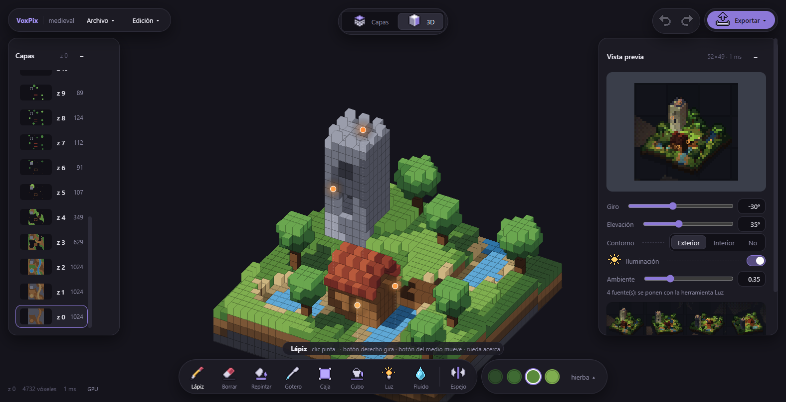

# El editor

`npm run dev` y abre http://localhost:5190. La app arranca con la escena de muestra: un rincón medieval de 32 x 32
vóxeles con sus luces.

## La pantalla

- **Arriba a la izquierda:** el menú *Archivo* (nuevo, escena de muestra, abrir, guardar, importar de pxl) y el menú
  *Edición* (deshacer, rehacer, tamaño del lienzo).
- **Arriba en el centro:** cómo se edita, por *Capas* o en *3D* (Tab cambia de uno a otro).
- **Arriba a la derecha:** deshacer, rehacer y *Exportar*.
- **Izquierda:** las capas (cada altura z, con su miniatura y cuántos vóxeles tiene).
- **Derecha:** la vista previa, con su giro, elevación, contorno e iluminación, y los 8 ángulos debajo.
- **Abajo:** las herramientas, sus opciones y los tonos de la rampa elegida (▴ abre la paleta completa).
- **Abajo a la izquierda:** la celda bajo el ratón, cuántos vóxeles hay, lo que tardó el render y si se pinta en la
  GPU o en la CPU (un clic cambia de una a otra).

Las ventanas flotantes se arrastran por su cabecera y se apartan solas de los menús. Un doble clic en la cabecera
las devuelve a su sitio.

## Coordenadas

x va hacia el este, y hacia el norte y z hacia arriba. El pivote (los pies del modelo, la celda 0, 0, 0) está en el
centro del lienzo, y la capa 0 es el suelo. *Edición > Tamaño del lienzo* cambia el ancho, el fondo y las capas
(hasta 256). Si algo queda fuera, se puede recortar o conservar.

## Por capas y en 3D

- **Capas:** se pinta la capa z vista desde arriba, con el norte arriba y la capa de debajo en fantasma. La rueda o
  W/S cambian de capa. Clic izquierdo usa la herramienta; clic derecho borra.
- **3D:** se pinta sobre el modelo. El lápiz pone un vóxel en la cara que tocas, y las demás herramientas actúan
  sobre el vóxel que señalas. El botón derecho gira, el del medio mueve la vista y la rueda acerca. Un doble clic
  con el del medio la centra.

## Herramientas

| Herramienta | Tecla | Qué hace |
|---|---|---|
| Lápiz | B | Pinta con el material elegido. |
| Borrar | E | Quita vóxeles. |
| Repintar | P | Cambia el material de lo que ya hay. |
| Gotero | I | Copia el material de un vóxel. |
| Caja | R | En capas, arrastra un rectángulo (con el botón derecho, lo vacía). En 3D, una caja entre dos huecos, con las alturas entre los dos. |
| Cubo | G | Rellena la mancha contigua de la capa (o la vacía con el botón derecho). |
| Luz | L | Pone una fuente de luz en la celda, o la quita si ya hay una. El tipo se elige en sus opciones: antorcha, lámpara, brasero, neón rosa, neón cian o pantalla. |
| Fluido | F | Agua. *Verter*: cae mientras mantienes pulsado y se reparte. *Grifo*: un clic deja una fuente continua. *Llenar*: llena de una vez, hasta esa altura, todo lo conectado, como una cuenca. *Fijar* lo deja como vóxeles. |
| Espejo | M | Pinta también lo simétrico respecto al eje x que indiques. |

Ctrl+Z deshace y Ctrl+Y (o Ctrl+Mayús+Z) rehace. Cada trazo, caja, relleno o vertido es un solo paso.

## Paleta

El color no se elige suelto: se elige una **rampa** (un material, del oscuro al claro) y su tono base. El render
mueve el tono dentro de la rampa según la luz, así que la imagen solo tiene colores de la paleta. Ver
[El render](render.md).

Los tonos de la rampa elegida están en la barra de abajo; ▴ abre la paleta completa, con tres pestañas:

- **Rampas:** elegir rampa y tono. Con *Editar* se cambia la paleta:
  - un clic en un tono abre el selector de color, y lo pintado con él cambia también;
  - el clic derecho quita el tono (lo pintado pasa al más parecido de la rampa);
  - **+** añade un tono más oscuro al principio o más claro al final;
  - se puede renombrar la rampa, subirla, bajarla y hacerla emisiva (**✦**: brilla sola);
  - **✕** borra la rampa (lo pintado con ella pasa al color más parecido de las demás);
  - *Quitar sin usar* quita las rampas que ningún vóxel usa.
- **Nueva:** una rampa generada desde un color. Eliges el color base, cuántos tonos y cuánto giran. Las sombras
  giran hacia el frío y las luces hacia el cálido, como hace a mano un pixel artist, en vez de solo oscurecer. El
  color base queda dentro de la rampa.
- **Paletas:** paletas de pixel art de [Lospec](https://lospec.com/palette-list), con sus autores: PICO-8, Sweetie
  16, Endesga 32, Apollo, Endesga 64, AAP-64 y Resurrect 64. También un archivo `.hex` o `.gpl`, o colores pegados.
  Se agrupan en rampas solas, siguiendo cómo las diseñó su autor (de oscuro a claro, aunque giren de tono). Hay dos
  opciones:
  - *Añadir* pone sus rampas detrás de las tuyas;
  - *Reemplazar* cambia la paleta entera, y lo pintado pasa al color más parecido de la nueva.

Todo cambio de paleta se deshace con Ctrl+Z, junto con los vóxeles que tocó. Caben hasta 64 rampas de hasta 16 tonos.

## Vista previa e iluminación

La vista previa es el mismo render que se exporta. El encuadre es el de los sprites (64x48 con el pivote en 32,42)
si el modelo cabe; si no, uno que lo contiene en cualquier giro. Se mira igual que en 3D: botón derecho para girar,
el del medio para mover y la rueda para acercar.

Con *Iluminación*, las fuentes de luz del modelo alumbran cada cara de vóxel, con sombras de los propios vóxeles y
parpadeo, y *Ambiente* oscurece el resto. Poner una luz la enciende sola.

## Animación

Abajo, encima de las herramientas, está la **línea de tiempo**: los cuadros de la animación, con el actual resaltado.
Cada cuadro es el modelo entero; se edita el actual con las herramientas de siempre, y cada cuadro tiene su deshacer.

- **◀ ▶ ▶|**: cuadro anterior, reproducir en bucle, siguiente. **+ Cuadro** copia el actual detrás; **Vacío** pone uno
  vacío; **← →** lo mueven; **Borrar** lo quita.
- **ms**: la duración del cuadro (con **todos**, la de todos).
- **Cebolla**: en el editor por capas se ven, como recuadros fantasma, los vóxeles del cuadro anterior que el actual
  no tiene o tiene de otro color.
- **Rig…** abre el rig por partes: cada parte es una caja de vóxeles (y, si quieres, solo unas rampas) con su
  pivote (la cadera) y su pie; cada cuadro del rig dice cuánto se mueve cada parte (dx, dy, dz) y cuánto adelanta el
  pie (paso). **Generar cuadros** rehace los cuadros 1..n desde el cuadro 0, que pasa a ser la pose de reposo (R).
- **Hoja PNG** y **GIF** exportan la animación en el ángulo de la vista previa, a la escala elegida.
- **Guardar** guarda los cuadros y el rig en el `.voxpix.json` (versión 2); sin animación, el archivo es el de siempre.

Lo mismo por la API de agentes: `docs/api-agentes.md`, Animación.

## Explorar

El botón **Explorar** (arriba, junto a Capas y 3D) te pone dentro del modelo en primera persona, con un personaje
invisible: caminas por tu escena, tu edificio o tu personaje como en un juego.

- Clic en la vista para mirar con el ratón. WASD o las flechas para andar, Espacio para saltar, Mayús para correr.
- **F** vuela (Espacio sube, C baja), **R** vuelve al inicio y **Esc** suelta el ratón; otro Esc sale.
- **Altura**: lo alto que es el personaje, de 1 a 32 vóxeles (1 por defecto). Con 1 ves el modelo como un bicho
  pequeño; con 16, como alguien de su tamaño. **Visión**: el campo de visión.
- Choca con lo que bloquea (los materiales: la hierba se atraviesa, el vidrio no), sube escalones de 1, y el agua se
  vadea. Debajo del modelo hay un suelo infinito.
- El render es el del núcleo (`renderFirstPerson`, `src/core/explore.ts`) con la paleta cerrada y el contorno de la
  vista; por la GPU si hay (va a 60 fps), y el oráculo del render compara las dos rutas.
- Con **Iluminación** encendida, las fuentes de luz del modelo alumbran en Explorar igual que en la vista previa (la
  misma luz por cara y las mismas capas MULTIPLY/ADD), y el cielo y el suelo se oscurecen con el ambiente.

## Exportar

- **pxl: N ángulos:** un `.px.js` con un sprite por ángulo y una hoja. Se construye con
  `node vendor/pxl/bin/pxl.js build`.
- **pxl: capas:** el modelo como un sprite por altura (`<nombre>_zNN`). Se vuelve a importar igual.
- **Modelo (.voxpix.json):** el modelo con su paleta y sus luces.
- **PNG:** la vista o la hoja de ángulos, a x1, x2, x4 o x8, con fondo transparente. Con la iluminación encendida,
  sale iluminado.

## Importar de pxl

*Archivo > Importar de pxl* lee un `.px.js` con dos opciones:
- una pila de capas `<prefijo>_zNN` como modelo (así se pueden escribir modelos enteros como código);
- un sprite como plano de vóxeles, de frente o como una capa, para un modelo nuevo o para el actual.

Las directivas `// voxpix: outline #rrggbb` y `// voxpix: emissive <teclas de rampa>` del `.px.js` fijan el color
del contorno y las rampas que brillan solas.

## Render en la GPU

Con WebGL2, el render y la luz se calculan en la GPU (`src/view/gpu/voxrender.ts`) y dan los mismos píxeles que la
CPU. En un paisaje de 128 x 128, el render pasa de ~400 ms a ~5 ms. `?ruta=cpu` fuerza la CPU.
